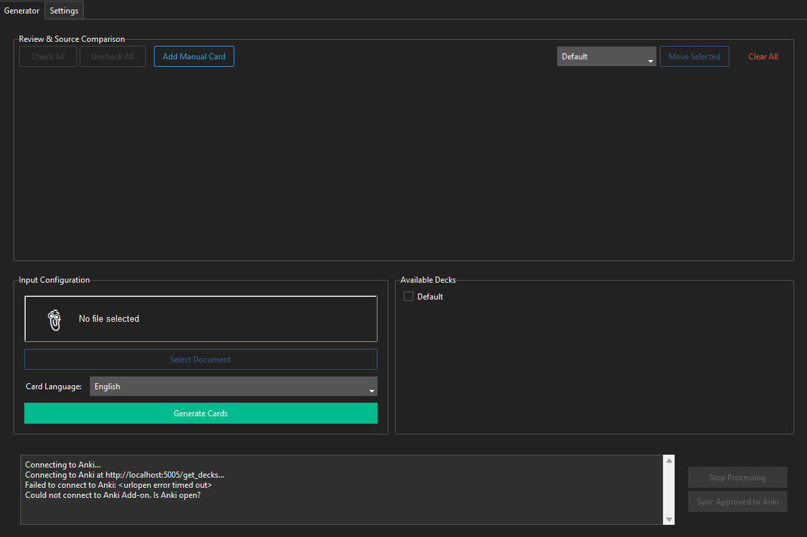
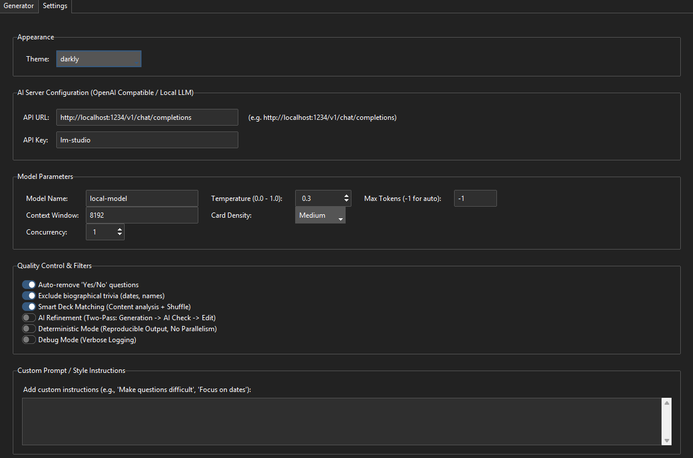

# NeuralDeck 0.2

[](https://github.com/AegeanWorks/AIKit)

<p align="center">
  
</p>

<p align="center">
  <b>Your personal, privacy-focused AI assistant for creating Anki flashcards from any document.</b>
  <br />
  <br />
  
  
  
  
  
</p>

---

## Table of Contents

1. [Cold-Start Quick Reference](#-30-second-cold-start-quick-reference)
2. [What's Inside](#-whats-inside)
3. [About](#about)
4. [Why NeuralDeck?](#why-neuraldeck)
5. [Features](#features)
6. [Screenshots](#screenshots)
7. [Quick Start](#quick-start)
8. [Installation](#installation)
   - [Prerequisites](#prerequisites)
   - [Setup NeuralDeck](#1-install-neuraldeck)
   - [Setup Anki Bridge](#2-setup-anki-bridge)
9. [Usage Guide](#usage-guide)
10. [Configuration Settings](#configuration-settings)
11. [Architecture](#architecture)
    - [Module Overview](#module-overview)
    - [Data Flow](#data-flow)
12. [Testing](#testing)
13. [Troubleshooting](#troubleshooting)
14. [Building the Executable](#building-the-executable)
15. [Security](#security)
16. [Contributing](#contributing)
17. [License](#license)

---

## ⚡ 30-Second Cold-Start Quick Reference

- **Runtime Prerequisites**: Python 3.10+, Anki desktop with the NeuralDeck Bridge add-on, and an OpenAI-compatible local LLM server (LM Studio recommended)
- **Canonical Regression Shield Gate**:
  ```bash
  python -m pytest tests
  ```

### 🛠️ AIKit Commands (run from the AIKit workspace root)

| Role | Command |
|---|---|
| Status, task and gates | `python aikit.py status NeuralDeck` |
| Delivery check | `python aikit.py check NeuralDeck` |
| Repair memory and map | `python aikit.py fix NeuralDeck` |
| Resume an interrupted task | `python aikit.py resume NeuralDeck` |

## 📦 What's Inside

```text
NeuralDeck/
├── README.md
├── .gitignore
├── COMMERCIAL.md
├── .aikit/                  <- project memory: project, guidelines, decisions, ledger, map
├── .github/
├── anki_addon/              <- Anki bridge add-on
├── screenshots/             <- README images
├── tests/                   <- regression suite
├── main.py
├── ui.py
├── document_processor.py
├── pipeline_utils.py
├── settings_io.py
├── anki_integration.py
├── debug_anki.py
├── debug_llm.py
├── requirements.txt
├── config.example.json
├── banner.png
├── LICENSE
├── LICENSES/                 <- REUSE license texts
└── REUSE.toml                <- Machine-readable SPDX metadata
```

---

## About

**NeuralDeck** is a powerful desktop application that transforms your study materials—PDFs, Word documents, and PowerPoints—into high-quality Anki flashcards. By leveraging the power of local Large Language Models (LLMs), it offers a completely offline and private workflow, ensuring your data never leaves your computer.

It's designed for students, researchers, and lifelong learners who want to automate the tedious process of card creation without sacrificing control or privacy.

---

## Why NeuralDeck?

- **🧠 Intelligent & Automated**: Go from a 300-page textbook to a ready-to-study Anki deck in minutes, not hours.
- **🔒 100% Private**: All processing happens locally. Your documents and generated cards are never sent to the cloud.
- **🤖 LLM-Powered**: Utilizes state-of-the-art local LLMs (like Llama 3, Mistral, or Phi-3 via LM Studio) to understand context and generate accurate, relevant questions.
- **🔧 Fully Controllable**: A comprehensive UI allows you to review, edit, approve, or discard every single card before it's synced to Anki.
- **🌐 Multi-Format Support**: Natively handles `.pdf`, `.docx`, `.pptx`, and `.txt` files.
- **🔌 Seamless Anki Integration**: A custom Anki add-on provides a direct bridge for one-click synchronization.
- **⚡ High Performance**: Multi-threaded processing with intelligent concurrency control.
- **🛡️ Resilient**: Built with failure isolation to handle corrupted pages and unstable LLM responses gracefully.

---

## Features

### Core Features

| Feature | Description |
|---------|-------------|
| **Local First Processing** | Connects to any OpenAI-compatible local server, with a default setup for LM Studio. |
| **Multi-Document Support** | Extracts text from PDF, Word (`.docx`), PowerPoint (`.pptx`), and plain text (`.txt`) files. |
| **Smart Deck Matching** | Automatically categorizes generated cards into your existing Anki decks by analyzing content. |
| **AI Refinement Mode** | Optional second AI pass for grammar correction, question clarity, and consistency. |
| **High-Density Generation** | Forces exhaustive detail extraction for complex subjects like medicine or law. |
| **Interactive Review & Edit** | User-friendly interface to edit questions, answers, and deck assignments before syncing. |
| **Bulk Operations** | Check/uncheck all cards, add manual cards, and move multiple cards to different decks. |
| **Session Persistence** | Workspace automatically saved. Resume your review session anytime. |
| **Resilient Pipeline** | Handles corrupted document pages and unstable LLM responses without crashing. |

### Advanced Features

- **Deterministic Mode**: Ensures reproducible output for testing and consistency.
- **Debug Mode**: Verbose logging for troubleshooting.
- **Custom Prompts**: Guide AI behavior with custom instructions.
- **Card Density Control**: Low (concepts), Medium (balanced), High (exhaustive).
- **Parallel Processing**: Configurable concurrency for faster generation.
- **Smart Filtering**: Automatic removal of Yes/No questions and duplicate content.

---

## Screenshots

### Main Interface

<p align="center">
  
</p>

The main interface provides a clean, intuitive workflow for generating flashcards. Select your document, configure generation settings, and watch as AI-powered cards are created in real-time.

---

## Quick Start

```bash
# 1. Clone and install
git clone https://github.com/Aegean-E/NeuralDeck.git
cd NeuralDeck
pip install -r requirements.txt
cp config.example.json config.json   # optional; use `copy` on Windows cmd

# 2. Install Anki Bridge (see Installation section)

# 3. Run NeuralDeck
python main.py

# 4. Start LM Studio, load a model, start server on port 1234

# 5. Open Anki and enjoy!
```

---

## Installation

### Prerequisites

| Requirement | Version | Notes |
|-------------|---------|-------|
| **Python** | 3.10+ | Required for running the application |
| **Anki** | Desktop | Must be running for sync to work |
| **Local LLM Server** | - | LM Studio recommended |

### Recommended LLM Models

- **Meta-Llama-3-8B-Instruct** - Excellent general-purpose model
- **Mistral-7B-Instruct** - Fast and efficient
- **Phi-3-mini** - Lightweight option for older hardware
- Any OpenAI-compatible model via LM Studio, Ollama, or text-generation-webui

### 1. Install NeuralDeck

```bash
# Clone the repository
git clone https://github.com/Aegean-E/NeuralDeck.git
cd NeuralDeck

# Create virtual environment (recommended)
python -m venv venv
source venv/bin/activate  # Linux/macOS
# or
venv\Scripts\activate  # Windows

# Install dependencies
pip install -r requirements.txt

# Optional: Install development dependencies for testing
pip install pytest
```

### Portable Executable (No Installation Required)

If you prefer not to install Python dependencies, you can use the pre-built portable executable:

1. Download the latest release from the [Releases](https://github.com/Aegean-E/NeuralDeck/releases) page
2. Extract the ZIP file to your preferred location
3. Run `NeuralDeck.exe`
4. **Note**: The Anki Bridge add-on must still be installed separately (see below)

> ⚠️ **Important**: Even when using the portable executable, you must install the Anki Bridge add-on to enable synchronization with Anki.

### 2. Setup Anki Bridge

To allow NeuralDeck to communicate with Anki, install the included bridge add-on:

1. Open **Anki**
2. Navigate to **Tools** > **Add-ons** > **View Files**
3. Create a new folder named `NeuralDeckBridge`
4. Copy the contents of the `anki_addon` folder (`__init__.py` and `manifest.json`) from this project into the new folder
5. **Restart Anki**

> **Verification**: Look for `NeuralDeck Bridge running on port 5005...` in the Anki terminal output.

---

## Usage Guide

### Step 1: Start Your Local LLM

1. Open **LM Studio**
2. Download and load a model (e.g., `Meta-Llama-3-8B-Instruct`)
3. Navigate to the **Local Server** tab
4. Click **Start Server**
5. Default endpoint: `http://localhost:1234/v1/chat/completions`

### Step 2: Launch Anki

Ensure Anki is running with the NeuralDeck Bridge add-on active.

### Step 3: Run NeuralDeck

```bash
python main.py
```

### Step 4: Generate Cards

1. Click **Select Document** to choose your source file (`.pdf`, `.docx`, `.pptx`, `.txt`)
2. Select your target **Language** (e.g., English, Spanish, French)
3. Choose which Anki decks the AI can assign cards to (or let Smart Deck Matching handle it)
4. Configure **Card Density**:
   - **Low**: Big-picture concepts and key definitions
   - **Medium**: Balanced coverage of facts and concepts
   - **High**: Exhaustive detail extraction
5. Click **Generate Cards**

### Step 5: Review & Sync

- Cards appear in real-time in the Review area
- Edit questions/answers directly in the entry boxes
- Change assigned deck from the dropdown
- Check/uncheck cards to approve or discard
- Click **Sync Approved to Anki** to add cards to your collection

### Bulk Operations

- **Check All**: Select all generated cards
- **Uncheck All**: Deselect all cards
- **Add Manual Card**: Create custom cards manually
- **Move to Deck**: Bulk move selected cards to a different deck

---

## Configuration Settings

All settings are accessible in the **Settings** tab and are saved automatically to `config.json`.

<p align="center">
  
</p>

Customize every aspect of the card generation process from the Settings panel. Configure your LLM connection, adjust generation parameters, and fine-tune the AI's output to match your learning needs.

| Setting | Description | Default |
|---------|-------------|---------|
| **Theme** | Any of the 18 standard `ttkbootstrap` themes | `darkly` |
| **API URL** | Local LLM server endpoint | `http://localhost:1234/v1/chat/completions` |
| **API Key** | Server authentication key | `lm-studio` |
| **Model Name** | Model identifier | `local-model` |
| **Temperature** | AI creativity (0.0=deterministic, 1.0=creative) | `0.7` |
| **Max Tokens** | Maximum tokens per response | `-1` (auto) |
| **Card Density** | Detail level: Low/Medium/High | `Medium` |
| **Concurrency** | Parallel threads (auto-limited to CPU cores) | `1` |
| **Filter 'Yes/No'** | Remove simple Yes/No questions | `True` |
| **Smart Deck Matching** | Content-aware deck assignment | `True` |
| **AI Refinement** | Second pass for quality improvement | `False` |
| **Deterministic Mode** | Fixed seed for reproducible output | `False` |
| **Debug Mode** | Verbose logging | `False` |
| **Custom Prompt** | Additional AI instructions | `(empty)` |

### Environment Variables

| Variable | Description | Default |
|----------|-------------|---------|
| `NEURALDECK_CONFIG` | Custom config file path | `config.json` beside the app |
| `NEURALDECK_LOG` | Log file location | `session.log` beside the app |

By default, `config.json`, `session_cache.json` and `session.log` live beside the application, so launching NeuralDeck from any working directory keeps one set of settings. In a frozen one-file build they live beside the executable, not in the executable's temporary extraction folder. A relative environment override is resolved against the application directory; an absolute override is used as given, and nested log directories are created automatically. The session cache is stored beside the resolved config file. Config and session writes use a hidden lock sibling, a unique temporary file, `fsync` and an atomic replace, so an interrupted process cannot leave truncated JSON; the `.lock` siblings are kept for cross-process coordination and ignored by Git; on POSIX, new files are created with `0600` and an existing mode is preserved. `config.json` is personal and untracked; start from `config.example.json`. Malformed or wrong-shaped JSON is moved to a `.corrupt_<timestamp>` sibling instead of being overwritten; a file that cannot be read because of an I/O error is left in place and blocks subsequent saves until it is removed or the application is restarted. Temporary files older than one day are cleaned at startup. On Windows NTFS, the replacement preserves the existing file's ACLs and attributes; filesystems without `ReplaceFileW` support fall back to `os.replace` without that metadata guarantee.

---

## Architecture

### Module Overview

```
NeuralDeck/
├── main.py                 # Application entry point
├── ui.py                  # Main GUI (ttkbootstrap)
├── document_processor.py  # Document parsing & card generation
├── pipeline_utils.py      # Utilities (stats, validation, logging)
├── settings_io.py         # Settings paths, atomic JSON persistence, numeric parsing
├── anki_integration.py   # HTTP client for Anki bridge
├── anki_addon/           # Anki-side add-on
│   ├── __init__.py       # Bridge server (port 5005)
│   └── manifest.json     # Add-on metadata
├── tests/                # Test suite
└── config.json           # User settings
```

### Detailed Module Documentation

#### `main.py`
Simple entry point that initializes and launches the GUI.

```python
from ui import AnkiGeneratorUI

def main():
    app = AnkiGeneratorUI()
    app.mainloop()
```

#### `ui.py` - User Interface
- **Framework**: ttkbootstrap (Bootstrap-styled Tkinter)
- **Features**:
  - Document selection and processing controls
  - Real-time log display
  - Interactive card review table
  - Settings panel with live updates
  - Concurrent thread management
  - Session state persistence

#### `document_processor.py` - Core Processing Engine

| Function | Description |
|----------|-------------|
| `extract_text_from_pdf()` | PDF text extraction with PyPDF2, handles encrypted/corrupt files |
| `_extract_text_from_docx()` | Word document parsing via python-docx |
| `_extract_text_from_pptx()` | PowerPoint extraction via python-pptx |
| `_extract_text_from_txt()` | Plain text file reading |
| `extract_text_from_document()` | Unified dispatcher for all formats |
| `check_llm_server()` | Connectivity check with fallback TCP probe |
| `call_lm_studio()` | LLM API client with SSE streaming support |
| `smart_chunk_text()` | Context-aware text splitting respecting boundaries |
| `robust_parse_objects()` | JSON extraction from LLM responses (handles noise/markdown) |
| `filter_and_process_cards()` | Card validation, deduplication, deck matching |
| `refine_generated_cards()` | AI-powered quality improvement pass |
| `generate_qa_pairs()` | Main pipeline orchestration with ThreadPoolExecutor |

#### `pipeline_utils.py` - Utilities

| Class | Description |
|-------|-------------|
| `PipelineStats` | Thread-safe metrics tracking (timing, counts, memory) |
| `FailureLogger` | JSONL logging of failed chunks and rejected cards |
| `CardValidator` | Card quality validation (length, duplicates, content) |
| `ResourceGuard` | File size and chunk count limits |

#### `anki_integration.py` - Desktop Client

| Function | Description |
|----------|-------------|
| `check_anki_connection()` | Ping Anki bridge server |
| `get_deck_names()` | Fetch deck list via HTTP GET |
| `create_anki_deck()` | Send cards via HTTP POST |

#### `anki_addon/__init__.py` - Anki Bridge Server

| Component | Description |
|-----------|-------------|
| `AnkiBridgeHandler` | HTTP request handler |
| `do_GET /get_decks` | Returns deck names from Anki collection |
| `do_POST /add_cards` | Creates cards in Anki |
| `do_OPTIONS` | CORS preflight handling |
| `add_cards_to_anki()` | Core card creation with model/deck management |
| Security | Path traversal prevention, localhost-only enforcement |

### Data Flow

```text
Document (.pdf/.docx/.pptx/.txt)
  -> document_processor: extract text, chunk, generate cards through the local LLM
  -> pipeline_utils: validate, deduplicate, match decks
  -> UI review and approval
  -> anki_integration -> Anki Bridge (localhost:5005) -> Anki
```

---

## Testing

NeuralDeck includes a comprehensive test suite covering all core modules.

### Running Tests

```bash
# Run all tests
python -m pytest tests -v

# Or use the test runner
python tests/run_tests.py

# Run specific test file
python -m pytest tests/test_document_processor.py -v

# Run with coverage
python -m pytest tests --cov=. --cov-report=html
```

### Test Coverage

| Module | Test File | Coverage |
|--------|----------|----------|
| Anki Integration | `test_anki_integration.py`, `test_anki_integration_get_deck_names.py` | ✓ |
| Anki Addon | `test_anki_addon_logic.py`, `test_anki_addon_media.py` | ✓ |
| Document Processor | `test_document_processor.py`, `test_document_processor_extra.py` | ✓ |
| Pipeline Utils | `test_pipeline_utils.py` | ✓ |
| Settings I/O | `test_settings_io.py` | ✓ |
| Theme Allowlist | `test_ui_themes.py` | ✓ |
| Full Pipeline | `test_pipeline.py` | ✓ |
| Failure Isolation | `test_failure_isolation.py` | ✓ |
| Deterministic Mode | `test_deterministic.py` | ✓ |

**Total: 134 tests** (platform- and dependency-specific tests are skipped when their prerequisite is absent)

---

## Troubleshooting

### Anki Connection Failed

**Symptoms**: "Could not connect to Anki" error when fetching decks or syncing.

**Solutions**:
1. Ensure Anki is open and a profile is loaded
2. Verify the **NeuralDeck Bridge** add-on is installed in **Tools > Add-ons**
3. Check if port 5005 is available:
   ```bash
   netstat -an | grep 5005
   ```
4. Change port in add-on config if needed
5. Restart Anki

### PDF Text Not Found

**Symptoms**: "No text could be extracted" error.

**Cause**: PDF is likely a scanned image without OCR.

**Solutions**:
1. Use OCR tools (Adobe Acrobat, PDF24, or online services)
2. Convert to text-selectable PDF before processing
3. Try a different PDF source

### LLM Connection Error

**Symptoms**: "Connection Failed to http://localhost:1234..."

**Solutions**:
1. Open LM Studio and verify model is loaded
2. Start the Local Server (not just Chat)
3. Check firewall rules for localhost
4. Verify API URL matches LM Studio settings

### Memory Issues with Large Files

**Symptoms**: Application slows down or crashes.

**Solutions**:
1. Reduce **Concurrency** to 1
2. Use **Low** Card Density
3. Split large documents into smaller files

### Cards Not Appearing in Correct Deck

**Symptoms**: Cards sync but go to wrong deck.

**Solutions**:
1. Disable **Smart Deck Matching** for manual assignment
2. Check deck names in Anki for exact matches
3. Review card deck assignment in UI before sync

---

## Building the Executable

### Using PyInstaller

```bash
# Install PyInstaller
pip install pyinstaller==6.22.3

# Build executable
pyinstaller --noconsole --onefile --name "NeuralDeck" main.py
```

The executable is created at `dist/NeuralDeck.exe` on Windows.

### Build Requirements

- Windows 10+ (for .exe)
- Python 3.10+
- All requirements installed

---

## Security

- **Local-Only Processing**: All document processing happens on your machine
- **No Cloud Services**: Zero data leaves your computer
- **Localhost Communication**: Anki bridge restricts to 127.0.0.1 only
- **Path Traversal Protection**: Media file handling includes security checks
- **Input Validation**: Card content is validated before Anki submission

### Data Privacy

| Data | Location | Encryption |
|------|----------|------------|
| Documents | RAM only | N/A |
| Generated Cards | `session_cache.json` beside the resolved config | None |
| Settings | `config.json` beside the app, or `NEURALDECK_CONFIG` | None |
| Logs | `session.log` beside the app, or `NEURALDECK_LOG` | None |

**Recommendation**: Clear `session_cache.json` after syncing sensitive content.

---

## Contributing

Contributions are welcome! Here's how you can help:

### Reporting Issues

1. Check existing issues before creating new ones
2. Include steps to reproduce
3. Attach relevant logs (enable Debug Mode)
4. Specify OS, Python version, and Anki version

### Pull Requests

1. Fork the repository
2. Create a feature branch
3. Add tests for new functionality
4. Ensure all tests pass
5. Update documentation
6. Submit pull request

### Development Setup

```bash
# Clone and setup
git clone https://github.com/Aegean-E/NeuralDeck.git
cd NeuralDeck

# Create virtual environment
python -m venv dev
dev\Scripts\activate  # Windows
source dev/bin/activate  # Linux/macOS

# Install all dependencies
pip install -r requirements.txt
pip install pytest pytest-cov

# Run tests
python -m pytest tests/ -v
```

---

---

<p align="center">
  <sub>Built with ❤️ for learners everywhere</sub>
</p>

> **License history:** versions up to and including `agpl-final` remain available under GNU AGPL-3.0.

## 📜 License

Free for personal use under the Aegean License 1.1 (AL-1.1); see [LICENSE](LICENSE). Any commercial use needs the Aegean Commercial License 1.0 (ACL-1.0); see [COMMERCIAL.md](COMMERCIAL.md).
